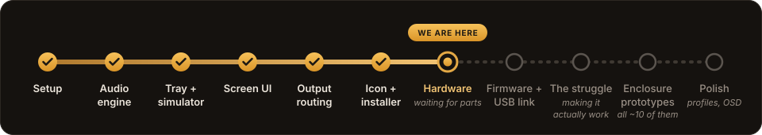
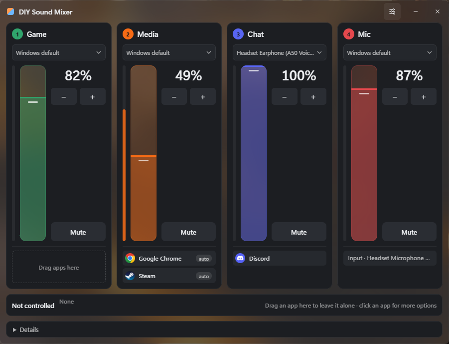
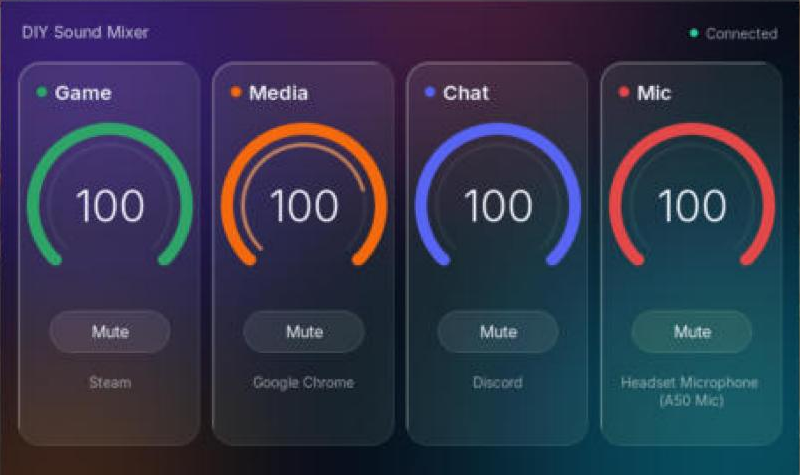

<p align="center">
  
</p>

<h1 align="center">DIY Sound Mixer</h1>

<p align="center">
  A homemade hardware audio mixer for Windows: four physical knobs and a 5" screen that control per-app audio, with software I own end to end.
</p>

## Why

Desktop mixers like BEACN Mix Create and software like SteelSeries Sonar do this well, until the company changes direction, a Windows update breaks it, or the app is abandoned. This project is the same idea, built from cheap parts and code that nobody can take away.

## The goal

- **Four channels: Game, Media, Chat and Mic.** Every app lands in a channel by rules (`discord.exe` goes to Chat, anything under `steamapps` goes to Game), or you drag it there yourself.
- **Physical control.** A knob and a mute button per channel, and a 5" touch screen that shows volume, mute and live levels.
- **Routing.** Each channel can go to its own output, for example Chat to the headset's voice channel and Media to a soundbar.
- **No drivers, no account, no cloud.** It uses the audio sessions Windows already has.
- **The PC is the brain.** The firmware only reports knob turns and draws what it is told, so new features are just a new version of the PC app.

## Where it stands

<p align="center">
  
</p>

**The software works. Hardware testing has not started yet.** The parts are ordered, and until they arrive, everything has been built and tested against a simulator that speaks the same protocol as the real hardware.

What works today:

- The PC app runs in the tray, starts with Windows and controls per-app volume, mute and output per channel.
- Per-app level meters using process loopback, so each app shows its own level.
- The real LVGL screen UI runs on the PC in a simulator window, connected to the app as if it were the device.
- English and Norwegian, switchable in the app. The tray menu and the screen follow along.
- A Windows installer.

Not started: the Pico firmware for the knobs, the screen firmware on the actual panel, and the 3D-printed enclosure. A stream mix with a virtual microphone is parked, since I don't stream.

| PC app | Screen UI (simulator) |
|---|---|
|  |  |

## Download

Get the installer from the [latest release](https://github.com/LostV/diy-sound-mixer/releases/latest). The app works without the hardware, as a per-app mixer in the window and the tray. It needs Windows 11, and SmartScreen will warn about an unknown publisher because the installer isn't code-signed: click **More info**, then **Run anyway**.

## Hardware

| Part | Job |
|---|---|
| Elecrow CrowPanel 5" (ESP32-S3, 800×480 touch) | The screen |
| Raspberry Pi Pico 2 W | Reads the knobs and buttons |
| 4× rotary encoder with push button (6 mm D-shaft) | Volume and mute per channel |

Both boards talk to the PC over USB serial with a small line-based JSON protocol. The full list, with prices and alternatives, is in [docs/handleliste-prototype.md](docs/handleliste-prototype.md) and [docs/hardware-alternativer.md](docs/hardware-alternativer.md) (in Norwegian).

## Repository

| Folder | Contents |
|---|---|
| [`pc-app/`](pc-app/) | The PC app in Rust + Tauri 2: audio engine, tray, settings window and hardware simulator |
| [`firmware/panel-esp32/`](firmware/panel-esp32/) | Screen UI in LVGL 9, with a desktop simulator |
| [`protocol/`](protocol/) | Protocol between the PC and the devices |
| [`docs/`](docs/) | Plans, shopping lists and design (mostly in Norwegian) |

## Building

Windows 11 only. You need Rust (stable, MSVC), Node.js and WebView2, which ships with Windows 11. From `pc-app/app`:

```bash
npm install
npm run tauri dev
```

`npm run tauri build` makes an installer in `pc-app/target/release/bundle/nsis/`. See [pc-app/README.md](pc-app/README.md) for usage and [firmware/panel-esp32/README.md](firmware/panel-esp32/README.md) for the screen simulator.

## A personal project

I build this for myself and share it so others can use it. Feature requests and questions are welcome as issues, but I can't promise to help or to add anything. I don't take pull requests. If you want something different, fork it and make it yours.

## License

[PolyForm Noncommercial 1.0.0](LICENSE.md). In short: use it, copy it, change it and share it freely, for anything that isn't making money. Selling it, or using it in a paid product or service, is not allowed.

Third-party parts keep their own licenses. The Inter font in `firmware/panel-esp32/fonts/` is under the [SIL Open Font License](firmware/panel-esp32/fonts/OFL.txt).
