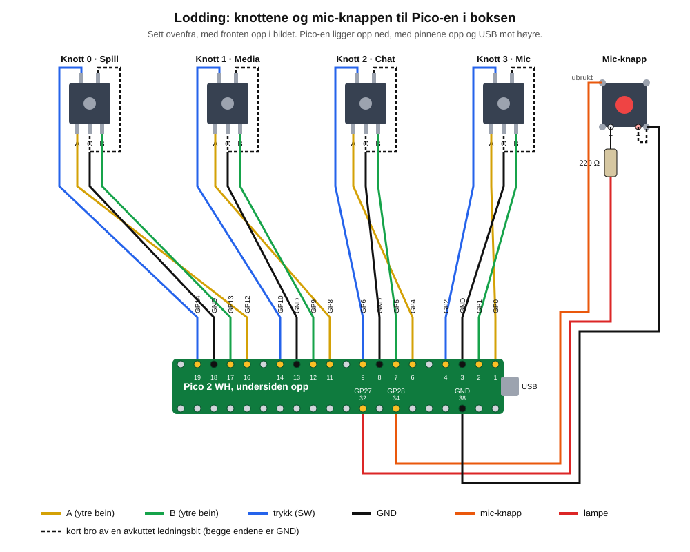

# Lodding – knottene og mic-knappen

Mål: alle fire knottene og mic-knappen er loddet til ledninger, plugget på Pico-en og testet, før boksen lukkes.

Vi lodder bare på beina til encoderne og knappen. På Pico-en lodder vi ingenting: hunn-endene på ledningene plugges rett på pinnene, slik som i test 1. Da kan alt tas fra hverandre igjen.

## Dette trenger du

| Hva | Antall |
|---|---|
| Han-hun-ledninger, 15 cm (de fra test 1 går fint) | 19 |
| Motstand 220 Ω (rød–rød–brun) | 1 |
| Krympestrømpe, ca. 3 mm | ca. 25 biter à 15 mm |
| Krympestrømpe, ca. 5 mm | 1 bit à 25 mm (over motstanden) |
| Loddebolt, loddetinn, flussgel, loddeveke | |
| Tredje hånd eller noe annet som holder delen fast | |
| Avbitertang, og avisoleringstang hvis du har | |
| Multimeter | |
| 1 ekstra encoder (du har 6) til å øve på | |

Hver knott får 4 ledninger, og mic-knappen 3. I tillegg lager du 5 korte broer av bitene du klipper av.

## Steg 1 – Ny fastvare på Pico-en

Pinnene er flyttet siden test 1, slik at hver knott får pinnene nærmest seg i boksen. Ellers ville ledningen til knott 0 blitt for kort. Pico-en trenger derfor ny fastvare (0.2.0) **før** du tester noe.

1. Ta Pico-en ut av breadboardet.
2. Avslutt mikser-appen.
3. Plugg Pico-en i PC-en og si fra, så laster jeg inn fastvaren.

## Steg 2 – Sett opp arbeidsplassen

- Sett loddebolten på **340 °C**.
- Fukt svampen litt, eller bruk messingull.
- Luft gjerne ut: røyken fra flussmiddelet er ikke farlig i små mengder, men ikke pust den rett inn.
- Legg bolten i holderen hver gang du slipper den. Spissen er varm lenge etter at du har slått den av.
- Ta encoderne og knappen **ut av skallet**. Det er mye lettere å lodde dem på bordet.

**Fortinn spissen:** Når bolten er varm, tørker du spissen på svampen og smelter litt tinn på den med en gang. En blank spiss med et tynt lag tinn leder varmen godt. Er den grå og matt, smelter ingenting skikkelig. Gjør dette hver gang den blir grå.

## Steg 3 – Øv på den ekstra encoderen

Gjør en hel knott på øve-encoderen først, med to ledninger du ikke trenger. Det er slik alle lærer, og det er derfor du har ekstra deler.

### Slik lodder du en ledning til et bein

1. **Klipp av han-enden** av ledningen, rett bak plasten. Hunn-enden skal sitte igjen: den skal på Pico-en senere. Ta vare på biten du klipper av.
2. **Tre på krympestrømpe først.** Skyv en 3 mm bit inn på ledningen og langt unna enden, minst 3 cm, så varmen ikke krymper den for tidlig. Dette er det lettest å glemme. Har du glemt det, må du klippe og begynne på nytt.
3. **Avisoler 3–4 mm.** Bruk avisoleringstanga, eller klem forsiktig med avbitertanga og dra. Vri trådene sammen så ingen stikker ut.
4. **Fortinn ledningen.** Hold bolten mot trådene i 1–2 sekunder og før tinnet inn mot trådene, ikke mot spissen. Trådene suger opp tinnet og blir blanke. Det holder med lite.
5. **Fortinn beinet.** Ha en dæsj flussgel på beinet, hold bolten mot det i et par sekunder og smelt en liten klatt tinn på tuppen.
6. **Legg dem sammen.** Hold ledningen langs beinet, med den fortinnede delen mot tinnet. La tredje hånd eller en klump Blu-Tack holde den i ro.
7. **Varm begge.** Trykk spissen mot der de møtes, i 1–2 sekunder, til tinnet smelter sammen. Ta bort bolten, og **hold helt stille i 3 sekunder** mens tinnet stivner.
8. **Sjekk:** Skjøten skal være blank og glatt og dekke begge. Dra forsiktig i ledningen; den skal sitte. Er den grå og kornete, eller en kule som ikke har festet seg, varmer du den igjen med litt fluss.
9. **Krymp:** Skyv krympestrømpa over skjøten, helt inn mot encoderen, og varm den til den sitter stramt. Bruk siden av loddebolten (ikke spissen) og stryk den over, eller en lighter på litt avstand. En hårføner blir ikke varm nok.

**Ikke hold bolten mot beinet lenger enn ca. 5 sekunder om gangen.** Encoderen er av plast inni og tåler ikke å bli kokt. Går det ikke, la den kjøle seg ned, ha på litt fluss og prøv igjen.

### Lag en bro

Broen er en kort ledning mellom to bein som begge skal til GND. Den sparer deg for én ledning til Pico-en.

1. Ta en av bitene du klippet av.
2. Klipp av metallpinnen, og klipp ledningen til ca. 4 cm.
3. Avisoler 3–4 mm i begge ender.
4. Lodd den mellom de to beina, akkurat som over. Husk krympestrømpe i begge ender.

## Steg 4 – Én knott

Encoderen har **3 bein på den ene siden** (A, C og B, med C i midten) og **2 bein på den andre siden** (trykknappen).

| Bein | Hva | Ledning |
|---|---|---|
| A (et ytre bein på 3-beinsiden) | Dreiing | ledning til Pico-en |
| C (det midterste) | GND | ledning til Pico-en, **og** broen |
| B (det andre ytre beinet) | Dreiing | ledning til Pico-en |
| Trykkbein 1 | Trykk | ledning til Pico-en |
| Trykkbein 2 | GND | bare broen, til C |

C-beinet får altså **både** en ledning og en bro. Lodd broen på C først, så ledningen ved siden av, eller vri ledningen og broen sammen før du fortinner dem.

Bruk gjerne **samme farge til samme bein på alle fire knottene**, så er det lett å feilsøke. Snur knotten feil vei etterpå, er det ikke noe problem: det retter jeg i fastvaren.

## Steg 5 – Plugg på og test én og én

Gjør én knott ferdig og test den før du tar neste. En feil blir mye lettere å finne da.

Pico-en ligger **opp ned** i boksen, med pinnene opp og USB-kontakten mot høyre. Pinnene 1–20 er da raden **mot knottene**. På undersiden av Pico-en (den som vender opp) står navnet på hver pinne, som GP12 og GND. Følg de navnene.

Hver knott får fire pinner rett ved siden av hverandre:

| Knott | A | B | GND (C) | Trykk |
|---|---|---|---|---|
| 0 Spill (lengst til venstre) | GP12 (pin 16) | GP13 (pin 17) | GND (pin 18) | GP14 (pin 19) |
| 1 Media | GP8 (pin 11) | GP9 (pin 12) | GND (pin 13) | GP10 (pin 14) |
| 2 Chat | GP4 (pin 6) | GP5 (pin 7) | GND (pin 8) | GP6 (pin 9) |
| 3 Mic (lengst til høyre) | GP0 (pin 1) | GP1 (pin 2) | GND (pin 3) | GP2 (pin 4) |

Test på bordet, med Pico-en plugget i PC-en og mikser-appen startet:

- Vri knotten: volumet på riktig kanal skal endre seg, ett steg per klikk.
- Trykk på knotten: kanalen skal mutes.

## Steg 6 – Mic-knappen

LED-knappen har 4 bøyde bein i hjørnene (knappen) og 2 rette bein i midten (lampen). Beinet ved den **blanke** siden er lampens **+**, og beinet ved den **rødmerkede** siden er **−**.

| Bein | Ledning |
|---|---|
| Et hjørnebein | ledning til **GP28** (pin 34) |
| Hjørnebeinet **på skrå** fra det | ledning til **GND** (pin 38), og bro til lampens − |
| Lampens − | bare broen, til GND-hjørnebeinet |
| Lampens + | motstanden, så ledning til **GP27** (pin 32) |

**Motstanden:** Klipp det ene beinet til ca. 8 mm og lodd det rett på lampens +. Lodd ledningen til motstandens andre bein. Tre den tykke krympestrømpa (5 mm) over hele motstanden og begge skjøtene, og krymp.

Disse tre pinnene sitter på **den andre raden** av Pico-en, den bakerste, nær USB-enden. Pin 32 og 34 har én pinne mellom seg, og pin 38 sitter fire pinner lenger mot USB.

**Test:** Trykk på knappen: mic-kanalen skal mutes, og lampen skal lyse. Lyser den ikke, er + og − byttet om. Si fra, så finner vi ut av det.

## Steg 7 – Sjekk for kortslutning

Gjør dette med Pico-en **frakoblet**, før du monterer.

1. Sett multimeteret på **gjennomgang**, som piper når to punkter er koblet sammen.
2. Hold pennene på to bein **ved siden av hverandre** på hver encoder, som A og C eller C og B. Det skal **ikke** pipe, bortsett fra der det er en bro.
3. Hold den ene pennen på et bein og den andre inne i hunn-enden av ledningen til det beinet. Det skal pipe.

Piper det der det ikke skal, er det en tinnbro mellom to bein. Fjern den med loddeveke: legg veken på, trykk bolten oppå, og veken suger tinnet opp.

## Steg 8 – Monter

1. Sett encoderne tilbake i skallet: akselen opp gjennom hullet, så ringen, skiva og mutteren. **Knott 0 lengst til venstre** sett forfra.
2. Sett mic-knappen i lommen og bøylen over med to M3 × 20, som på testplaten.
3. Skru Pico-en opp ned på L-delen, med USB mot kabelsporet til høyre.
4. Sett på ledningene etter tabellen, og test alt én gang til før du skyver L-delen på plass.
5. Samle ledningene med en strips eller litt tape, så de ikke drar i skjøtene.

## Feilsøking

| Problem | Løsning |
|---|---|
| Tinnet vil ikke feste seg på beinet | Mer fluss, og en ren og fortinnet spiss. Hold bolten mot beinet, ikke mot tinnet. |
| Skjøten er grå og kornete | Den ble flyttet mens den stivnet. Varm den igjen og hold stille. |
| Knotten teller feil vei | Bare si fra, så snur jeg den i fastvaren. |
| Knotten gjør ingenting | Sjekk GND-ledningen og broen med multimeteret. |
| Ett klikk teller to eller ingen | En skjøt har dårlig kontakt. Sjekk A og B. |
| Kanalen mutes av seg selv | Trykkbeinet har kontakt med GND der det ikke skal. Se etter tinnbro. |
