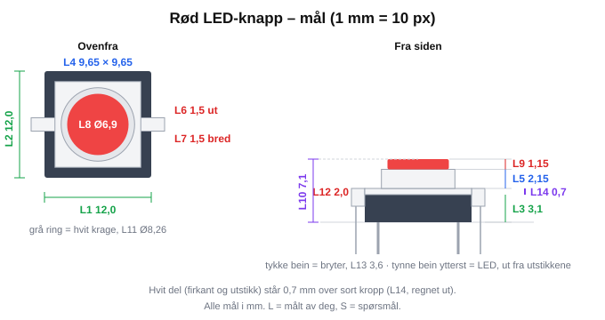
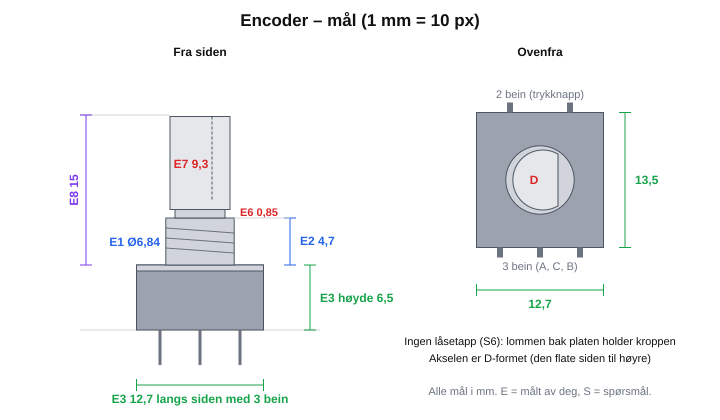

# Mål på delene

Målene skallet tegnes etter. Alle mål er i mm og tatt med skyvelære.
Hvert mål har en ID, så du kan skrive for eksempel «L5 er feil, skal være 2,4».

- **L** = målt av deg
- **S** = spørsmål: noe som mangler eller som jeg er usikker på

## Rød LED-knapp (mic-mute)

| ID | Hva | Mål | Merknad |
|----|-----|-----|---------|
| L1 | Sort kropp, bredde | 12,0 | |
| L2 | Sort kropp, dybde | 12,0 | |
| L3 | Sort kropp, høyde (uten bein) | 3,1 | |
| L4 | Hvit firkant, bredde × dybde | 9,65 × 9,65 | Lik begge veier |
| L5 | Hvit del, fra toppen av sort kropp opp til leppa mot rød hette | 2,15 | |
| L6 | Hvitt utstikk på siden, hvor langt det stikker ut forbi sort kropp | 1,5 | Ett på hver side, så 15,0 tupp til tupp |
| L7 | Hvitt utstikk, bredde | 1,5 | |
| L8 | Rød hette, diameter | 6,9 | |
| L9 | Rød hette, høyde over hvit krage | 1,15 | |
| L10 | Total høyde, bunnen av sort kropp til toppen av rød hette | 7,1 | Målt direkte. Det er dette tallet som gjelder for høyden. |
| L11 | Rund hvit krage rundt hetta, diameter | 8,26 | L5 er målt til toppen av denne |
| L12 | Hvite utstikk, tykkelse i høyden | 2,0 | Sitter oppe, i flukt med toppen av sort kropp (se sidebildet) |
| L13 | Bryterbeina under kroppen, lengde | ca. 3,6 | |
| L14 | Hvit del (firkant og utstikk) står over toppen av sort kropp | 0,7 | Regnet ut: L10 − L3 − L5 − L9. For lite til å måle, men synlig. Rød hette er flat. |

Fra sidebildet: de to tynne beina ytterst er LED-beina. De kommer ned fra tuppen av de hvite utstikkene, altså 1,5 mm utenfor den sorte kroppen på hver side. Lommen i skallet må ha plass til dem.

### Spørsmål

Alle besvart: S1 → L10, S2 → L11, S3 → L12, S4 → L13, S5 → L14.

## Gjengeinnsatser (M3)

| ID | Type | Høyde | Største diameter |
|----|------|-------|------------------|
| G1 | Lang | ca. 6 | 5,0 |
| G2 | Kort | ca. 4 | 5,0 |

**Testet: 4,9 mm hull er best** (testplaten, kort innsats G2, ca. 220 °C). Den gikk lettest inn, sitter godt og var den eneste som ikke presset smeltet plast opp av toppen. De mindre hullene (4,0 / 4,3 / 4,6) fikk plast ut over kanten.

Hullet må være ca. 1 mm dypere enn innsatsen, og stolpen bør ha minst 2 mm vegg rundt hullet.

## Encoder (knott)

| ID | Hva | Mål | Merknad |
|----|-----|-----|---------|
| E1 | Gjengehylsa, diameter | 6,84 | Vanlig M7-gjenge |
| E2 | Gjengehylsa, høyde over kroppen | 4,7 | Uten mutter og skive |
| E3 | Kroppen, bredde × dybde × høyde | 12,7 × 13,5 × 6,5 | 12,7 langs sidene med de tynne beina (3 og 2 bein), 13,5 langs sidene med de brede metallbeina. Høyden er uten bein. |
| E4 | Mutter + skive, tykkelse | 2,5 | |
| E5 | Gjenge som stikker opp over mutteren når den er skrudd helt ned | 2,3 | Stemmer med E2 − E4 = 2,2 |
| E6 | Smal hals mellom gjengen og akselen | 0,85 | |
| E7 | Akselen over halsen (D-formet) | 9,3 | Knottene har 6 mm D-hull, som Electrokit oppgir for akselen |
| E8 | Fra toppen av kroppen til tuppen av akselen | 15,0 | E2 + E6 + E7 = 14,85, stemmer |

Hva det betyr for skallet: platen encoderen sitter i klemmes mellom kroppen og mutteren. Da kan den være maks ca. 2,2 mm tykk der, ellers får ikke mutteren tak. Jeg tegner 2,0 mm.

### Spørsmål

| ID | Spørsmål | Hvorfor |
|----|----------|---------|
| S6 | ~~Låsetappen~~ **Besvart med bilder: ingen tapp som stikker opp.** Den lille firkanten ved ringen på toppen er flat. | Lommen bak platen griper rundt den firkantede kroppen i stedet, så encoderen ikke kan vri seg. |
| S7 | Besvart: akselen er D-formet, se E6–E8. | |
| S8 | Besvart: 12,7 langs siden med de 3 beina, se E3. | |

Alle mål på encoderen er klare.

### Fra databladet

Encoderen er en Bourns PEC11R-4215F-S0024 ([datablad](https://www.bourns.com/docs/Product-Datasheets/PEC11R.pdf), tegningen «PEC11R-4xxxF-Sxxxx»). Det stemmer med målene over:

| Hva | Datablad | Målt |
|-----|----------|------|
| Aksel, diameter | 6,0 ± 0,1 | |
| Aksel, over den flate siden | 4,5 (+0 / −0,05) | |
| Aksel, fra kroppen til tuppen (L) | 15 | 15,0 (E8) |
| Gjenge | M7 × 0,75 | Ø6,84 (E1) |
| Kropp | 12,5 × 13,4, høyde 6,5 | 12,7 × 13,5 × 6,5 (E3) |
| Trykknapp, vandring | 0,5 | |
| Bein, avstand | 5,0 | |
