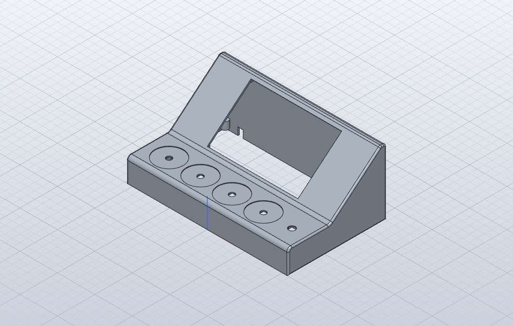
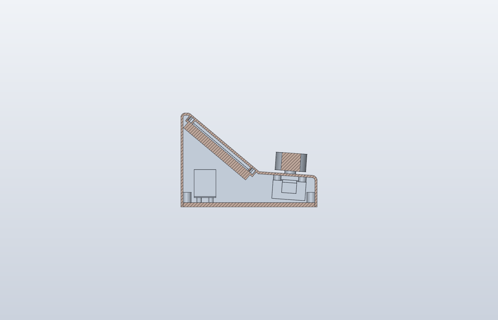
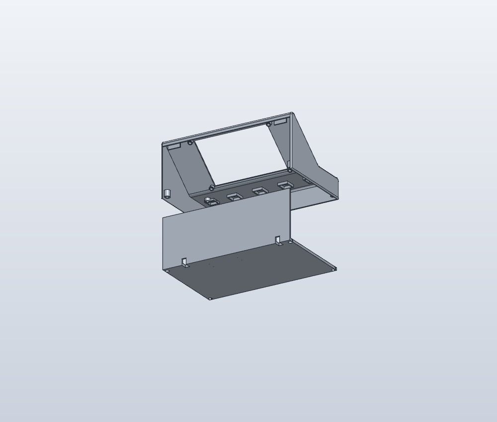

# Skallet

Det ferdige kabinettet: en kile med de fire knottene og mic-knappen foran, og skjermen på skrå bak. Målene til knotter og knapp kommer fra testplaten ([maal-deler.md](maal-deler.md)). Skjermmålene kommer fra Elecrows tegning av skjermen.

| Mål | |
|-----|---|
| Bredde | 216 mm |
| Dybde | 131 mm |
| Høyde bak | 88,5 mm |
| Høyde foran | 32 mm |
| Knott-flaten | flat, med en myk bue opp mot skjermen |
| Skjermvinkel | 40° fra bordet |

## Delene

I mappen `enclosure/shell/`:

| Fil | Hva | Antall |
|-----|-----|--------|
| `shell.stl` | Selve skallet, åpent i bunnen og bak | 1 |
| `bottom.stl` | L-delen: bunnplaten og bakveggen i ett, med fire små stolper til Pico-en | 1 |
| `ring.stl` | Fargering under en knott | 4, én i hver kanalfarge |
| `screen-frame.stl` | Testramme for skjermen, printes før skallet | 1 |
| `../testplate/button-bar.stl` | Bøylen til mic-knappen, den samme som på testplaten | 1 (du har den allerede) |
| `assembly.step` | Alt satt sammen, bare for å se på | |

## Slik er det bygget opp

*Snitt fra siden. Fronten er til høyre.*

*Skallet og L-delen sett bakfra. Når L-delen er av, kommer du til alle fire skjermstolpene gjennom den åpne baksiden.*

- **Skjermen** legges inn bakfra. Glasset går inn i hullet i skrå-flaten og ligger 0,6 mm under overflaten. Kretskortet skrus fast på fire stolper bak flaten, med M3-skruer i gjengeinnsatser.
- **Knottene og mic-knappen** sitter akkurat som på testplaten. Lommene, hullene og stolpene er de samme. Knott-flaten er helt flat, fordi en svak helning printes som synlige trinn, ett for hvert lag. Den går over i skjerm-flaten med en myk bue (radius 8 mm).
- **Fargeringene** ligger i en grunn forsenkning rundt hver knott, i flukt med overflaten. Mutteren på encoderen klemmer ringen fast, så du trenger verken lim eller skruer.
- **Pico-en** står opp ned på fire små stolper på bunnplaten, bak under skjermen. Pinnene peker da opp, så dupont-pluggene får plass.
- **L-delen** er bunnplaten og bakveggen i ett. Bakveggen sitter på L-delen og ikke på skallet, fordi skrutrekkeren og loddebolten må inn bakfra for å nå de to øverste skjermstolpene. Den skyves opp nedenfra: bakveggens øvre kant går inn bak to tapper under den avrundede toppkanten, og bunnplaten holdes av fire M3-skruer i hjørnene. Bunnplaten er 4 mm tykk, så boksen blir tung og står stødig når du vrir på knottene.
- **To spor i hjørnet** av L-delen slipper ut kablene: USB-C fra skjermen til venstre, USB fra Pico-en til høyre. Sporene er åpne nedover, så kablene legges inn nedenfra.

## Sjekk skjermen før du printer skallet

Skjermmålene kommer fra Elecrows tegning. Disse fem målte du med skyvelæret, og alle stemte innen 1 mm (3. november):

| ID | Hva | Fra tegningen |
|----|-----|---------------|
| K1 | Kretskortet, bredde × høyde | 137 × 84 |
| K2 | Glasset, bredde × høyde | 120,7 × 75,9 |
| K3 | Fra fremsiden av glasset til fremsiden av kretskortet | 5,7 |
| K4 | Avstand mellom skruehullene, bredde × høyde (senter til senter) | 130 × 77 |
| K5 | Hvor USB-C-kontakten sitter | Midt på venstre kortside, sett forfra |

Det er ikke helt nok. Glasset har bare 0,2 mm luft på hver side i hullet, så 0,5 mm for stort glass passer ikke. Et skruehull 1 mm feil gjør at skruen ikke treffer innsatsen. Print derfor **testrammen** `screen-frame.stl` først: den er en flat bit av skjerm-flaten med glasshullet og de fire stolpene. Den veier ca. 10 g og tar en halvtime.

- Print den med forsiden ned (den flate siden mot platen), uten support.
- Smelt inn fire gjengeinnsatser i stolpene.
- Legg skjermen inn bakfra. Glasset skal gli inn i hullet uten å presses, og kortet skal ligge flatt på alle fire stolpene.
- Skru fast med fire M3 × 6. Skruene skal gå rett inn uten at du må bøye kortet.
- Se fra forsiden: glasset skal ligge litt under kanten, og den svarte kanten rundt bildet skal være like bred på alle sider.

Passer det, printer du skallet. Er glasset for trangt eller hullene skjeve, si fra hvor det tar, så justerer jeg.

Ringene og L-delen kan du printe når som helst.

## Printe

PLA, lagtykkelse 0,2 mm, 4 vegger (Wall loops: 4), 15 % infill.

**Skallet** (ca. 110 g):
- Legg det **på bunnen**. Knott-flaten blir da en flat toppflate; slå gjerne på **ironing** for den. Skjerm-flaten heller 40°, så den får små lagtrinn. Bruk variabel lagtykkelse på den hvis de syns.
- Eller legg det **på ryggen** (bakkantene ned). Da står begge flatene nesten loddrett og blir glatte, men skallet blir 131 mm høyt.
- Slå på **support (tree, auto)**. Det trengs under stolpene og tappene inne i skallet, og på ryggen også under nederste kant av skjermhullet.

**L-delen** (ca. 170 g): bunnplaten ned og bakveggen stående rett opp. Ingen support.

**Ringene:** flat side ned, ingen support. Print én jobb per farge, så slipper AMS-en å bytte farge midt i. Det blir ingen «poop». Lag gjerne en ekstra av hver mens fargen først står i.

## Montere

Du trenger:

| Hva | Antall |
|-----|--------|
| Gjengeinnsatser M3, korte (G2, 4 mm) | 10 |
| M3 × 6 mm skruer | 8 (4 til skjermen, 4 til L-delen) |
| M3 × 20 mm skruer | 2 (bøylen til mic-knappen) |
| M2-skruer, 6–8 mm | 4 (Pico-en; de skjærer sine egne gjenger) |

1. **Gjengeinnsatser**, ca. 220 °C som på testplaten. L-delen er av, så skallet er åpent bak og under:
   - 4 i stolpene bak skjermhullet. Hold loddebolten rett inn i stolpen, på skrå inn gjennom den åpne baksiden.
   - 2 i stolpene ved mic-knappen
   - 4 i hjørnestolpene nede ved bunnen
2. **Encoderne:** Stikk akselen opp gjennom hullet innenfra. Legg på ringen, så skiva og mutteren, og stram mutteren.
3. **Mic-knappen:** Gjør som på testplaten. Legg knappen i lommen, bøylen over, og skru fast med to M3 × 20.
4. **Lodd ledningene** til encoderne og knappen. Det er ikke plass til dupont-plugger rett under encoderne i skallet, så her lodder vi som planlagt: klipp av hann-enden på ledningen, lodd den til beinet og krymp krympestrømpe over.
5. **Skjermen:**
   - Sett USB-C-kabelen i skjermen først.
   - Før skjermen inn gjennom den åpne baksiden, med glasset inn i hullet, og skru den fast med fire M3 × 6. De øverste skruene når du bakfra.
   - USB-C-pluggen sitter på venstre kortside. Den har ca. 10 mm å bøye seg på før sideveggen. Er kabelen for stiv, hjelper en vinklet USB-C-kabel.
6. **Pico-en:** Snu den opp ned, med pinnene opp, og skru den fast på stolpene på L-delen med fire M2-skruer. Sett på ledningene.
7. **Kablene:** Legg USB-kablene i sporene i hjørnet av L-delen, nedenfra.
8. **L-delen:** Skyv den opp i skallet nedenfra, med bakveggens øvre kant inn bak de to tappene. Skru den fast med fire M3 × 6 i hjørnene. Sett gjerne på små gummiføtter.

## Endre noe

Alle mål står øverst i `enclosure/shell/shell.py`. Si fra hva du vil endre, så bygger jeg filene på nytt. Skriptet sjekker også at skjermen, USB-pluggen, encoderne, bøylen og Pico-en ikke treffer skallet.
