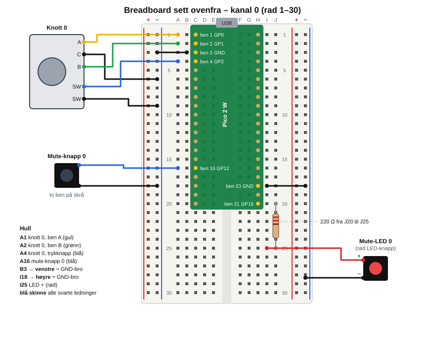

# Test 1 – knottene på breadboard

Mål: når du vrir på en knott, kommer det en linje på PC-en, og det lille lyset på Pico-en blinker. Til slutt virker alle 4 knottene og mic-mute-knappen med lys.

Ingen lodding trengs. Fastvaren ligger i [firmware/knobs-pico](../firmware/knobs-pico/).



## Slik leser du hullene

- Breadboardet har **rader med nummer** (1, 2, 3 …) og **kolonner med bokstav** (A–E til venstre for midtrenna, F–J til høyre).
- Et hull heter kolonne + rad, for eksempel **A1** eller **J25**.
- De 5 hullene **A–E i samme rad** er koblet sammen inni brettet. Det samme gjelder **F–J**. Midtrenna skiller dem.
- **Skinnene** ytterst (rød + og blå −) er koblet sammen hele veien nedover. Vi bruker bare de **blå** skinnene, og de er GND.

**Dra alltid ut USB-kabelen før du flytter ledninger.**

## Dette trenger du

| Del | Antall nå |
|---|---|
| Pico 2 WH | 1 |
| Encoder (knott) | 1, senere 4 |
| Rød LED-knapp (mic-mute) | 1 |
| Motstand 220 Ω (fargene rød–rød–brun) | 1 |
| Myke han-han-ledninger (65-pakken) | 2 |
| Han-hun-ledninger (hunn i én ende) | 9 |
| Micro-USB-kabel som overfører data | 1 |

---

## Steg 1 – Sjekk Pico-en

Snu Pico-en. Det skal stikke ut **to rader med metallpinner** på undersiden (det er «H» i WH). Hvis det bare er hull og ingen pinner, stopp og si fra.

## Steg 2 – Sett Pico-en i breadboardet

1. Legg breadboardet slik at **rad 1 er øverst**, akkurat som på bildet ditt.
2. Hold Pico-en med **USB-kontakten opp**, mot rad 1.
3. Pinnene på venstre side skal i **kolonne C, rad 1–20**. Pinnene på høyre side skal i **kolonne H, rad 1–20**.
4. Sjekk at alle pinnene står over et hull før du trykker. Trykk så **jevnt og bestemt** med to tomler på kantene av kortet. Det er stramt, og det er normalt.

Etterpå er A og B ledige til venstre og I og J ledige til høyre. Rad-nummeret er det samme som ben-nummeret på venstre side: ben 1 står i rad 1, ben 16 i rad 16.

Ser det ut som pinnene ikke passer i C og H, så ta et bilde og send meg det før du trykker.

## Steg 3 – Last inn fastvaren

Ingen ledninger ennå, bare USB.

1. Hold inne den lille hvite knappen **BOOTSEL** på Pico-en.
2. Plugg i USB-kabelen i PC-en mens du holder knappen. Slipp knappen.
3. En disk som heter **RP2350** dukker opp i Utforsker.
4. Si fra til meg, så kopierer jeg fastvaren dit. Du kan også kopiere filen `firmware/knobs-pico/build/knobs-pico.ino.uf2` dit selv.
5. Disken forsvinner, og Pico-en starter med den nye fastvaren.

Dra ut USB-kabelen igjen før neste steg.

## Steg 4 – GND-ledningen

Ta én **myk han-han-ledning**:

- Den ene enden i **B3** (rad 3 er ben 3, som er GND).
- Den andre enden i den **blå skinnen til venstre** (den innerste av de to venstre skinnene), et sted nær rad 3.

Nå er hele den venstre blå skinnen GND.

## Steg 5 – Knott 0

Encoderen har **3 bein på én side** og **2 bein på den andre siden**. Tre **hunn-enden** av en han-hun-ledning rett på hvert bein, og stikk **han-enden** i hullet i tabellen. Bruk gjerne samme farger som på tegningen, så er det lettere å feilsøke.

| Encoderbein | Han-enden går i |
|---|---|
| 3-beinsiden, ytterst på den ene siden (**A**) | **A1** |
| 3-beinsiden, **midterste** (**C**) | **venstre blå skinne** |
| 3-beinsiden, ytterst på den andre siden (**B**) | **A2** |
| 2-beinsiden, det ene beinet | **A4** |
| 2-beinsiden, det andre beinet | **venstre blå skinne** |

Det spiller ingen rolle hvilket ytre bein du kaller A. Blir retningen feil, bytter du bare de to ledningene i A1 og A2. **Når knott 0 teller riktig vei, kobler du de andre knottene på nøyaktig samme måte**, med det samme ytre beinet i A-hullet. Hvis hunnkontaktene sitter løst på de flate beina, kan du klemme dem forsiktig sammen med en tang.

## Steg 6 – Første test

1. Plugg i USB-kabelen.
2. **Vri knotten.** Det lille lyset på Pico-en (ved USB-kontakten) skal blinke kort for hvert klikk.
3. **Trykk knotten ned.** Lyset blinker igjen.
4. Si fra, så leser jeg det Pico-en sender. Jeg sjekker at hvert klikk blir telt én gang og i riktig retning.

Hvis du vil se det selv, kan du skrive dette i en terminal (bytt `COM5` med porten Pico-en fikk):

```bash
arduino-cli monitor -p COM5 -c baudrate=115200
```

Du skal se linjer som `{"t":"enc","ch":0,"d":1}` (ett klikk med klokka), `"d":-1` (mot klokka) og `{"t":"btn","id":"enc0","s":1}` (trykket inn).

Dra ut USB-kabelen før neste steg.

## Steg 7 – Mic-mute-knappen

Hver kanal mutes med et trykk på knotten (eller på skjermen senere), så vi har bare **én** egen knapp: en mic-mute-knapp med rødt lys. Den kan brukes i blinde, og lyset viser at mikrofonen er av. Det er den **røde LED-knappen**. Den svarte knappen trengs ikke.

LED-knappen har 6 bein:

- De **4 bøyde beina i hjørnene** er selve knappen. Inni er de koblet sammen to og to, så du bruker bare 2 av dem: to bein **på skrå**, i hvert sitt hjørne. De to andre står ubrukt.
- De **2 rette beina i midten** er lampen. Beinet ved den **blanke** siden er **+**, og beinet ved den **rødmerkede** siden er **−** (testet på knappene fra Electrokit).

**Knappen** (venstre side):

| Bein | Går i |
|---|---|
| Ett hjørnebein | **A20** (ben 20, GP15) |
| Hjørnebeinet på skrå | **venstre blå skinne** |

**Lampen** (høyre side):

1. **Motstanden** (220 Ω, rød–rød–brun): bøy beina ned og sett den i **J16** og **J25**. Rad 16 på høyre side er ben 25, som er GP19. Det spiller ingen rolle hvilken vei den står.
2. **GND på høyre side:** én myk han-han-ledning fra **I18** til den **blå skinnen til høyre** (den ytterste). Rad 18 på høyre side er ben 23, som er GND.
3. **LED +**: han-hun-ledning fra beinet ved den blanke siden til **I25**.
4. **LED −**: han-hun-ledning fra beinet ved den rødmerkede siden til **høyre blå skinne**.

Test: plugg i USB, trykk på knappen og si fra. Jeg sjekker at trykket kommer frem som `mute3`, og slår lampen av og på fra PC-en. Lyser den ikke, snur du de to LED-ledningene.

## Steg 8 – Resten av knottene

Når knott 0 virker, kobles de tre andre på samme måte, bare i andre rader. Hold knotten likt som knott 0, og ha samme farger på de samme beina, så teller alle riktig vei. Alle C-bein og de andre trykknappbeina går til **venstre blå skinne**, akkurat som for knott 0.

| Kanal | A går i | B går i | Trykknapp går i |
|---|---|---|---|
| 0 Spill | A1 | A2 | A4 |
| 1 Media | A5 | A6 | A7 |
| 2 Chat | A9 | A10 | A11 |
| 3 Mic | A12 | A14 | A15 |

Rad 8, 13 og 18 til venstre er GND-ben, så de hoppes over.

Test hver knott for seg før du kobler den neste. Si fra når alle 4 er koblet, så sjekker jeg alle kanalene.

---

## Feilsøking

| Problem | Løsning |
|---|---|
| Ingen RP2350-disk | Prøv en annen USB-kabel. Hold BOOTSEL inne *mens* du plugger i. |
| Lyset blinker ikke når du vrir | Sjekk at det midterste beinet (C) går til blå skinne, og at B3 er koblet til den venstre blå skinnen. |
| Lyset blinker hele tiden, eller av seg selv | En hunnkontakt sitter løst. Klem den sammen eller bytt ledning. |
| Feil retning | Bytt ledningene i A1 og A2. |
| Ett klikk gir to linjer, eller to klikk gir én | Si fra, så endrer jeg én innstilling i fastvaren. |
| Mic-mute-knappen er «trykket» hele tiden, eller reagerer ikke | Du har brukt to hjørnebein som er koblet sammen inni knappen. Bruk to bein på skrå. |
| LED-en lyser ikke | Snu de to LED-ledningene. Sjekk at motstanden står i J16 og J25. |
