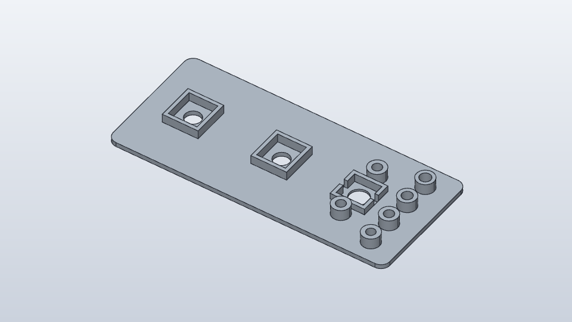

# Test 2: testplate for knottpanelet

En liten plate (125 × 55 mm) som tester at encoderne, mic-knappen og gjengeinnsatsene passer, før vi tegner hele skallet. Målene kommer fra [maal-deler.md](maal-deler.md).

*Sett bakfra. Forsiden er helt flat og ligger ned mot printeplaten.*

## Filer

I mappen `enclosure/testplate/`:

| Fil | Hva |
|-----|-----|
| `testplate.stl` | Selve platen |
| `button-bar.stl` | Liten bøyle som holder mic-knappen bakfra |
| `*.step` | Samme deler i CAD-format, hvis du vil åpne dem i et tegneprogram |
| `testplate.py` | Skriptet som lager filene (FreeCAD) |

## Printe

Åpne begge STL-filene i Bambu Studio. Innstillinger:

- **PLA**, lagtykkelse 0,2 mm
- **Platen med den flate forsiden ned** mot printeplaten (slik den åpnes, med stolpene opp)
- **Bøylen med den flate siden ned** (klossen og de to rørene peker opp)
- **Ingen support**
- **4 vegger** (Wall loops: 4), så stolpene til gjengeinnsatsene blir sterke
- 15–20 % infill

Tar ca. en halvtime.

## Hva som er på platen

Sett bakfra, med encoderne til venstre:

1. **To encoderlommer** med 40 mm mellom sentrene. Det gir 10 mm luft mellom to knotter på 30 mm.
2. **Lomme til mic-knappen**, med to stolper for bøylen.
3. **Fire teststolper** i en rad ytterst til høyre. Hullene blir større nedover: **4,0 – 4,3 – 4,6 – 4,9 mm**. Den nærmeste deg er minst.

## Steg

### 1. Gjengeinnsatsene (gjør dette først)

1. Bruk de **korte M3-innsatsene (ca. 4 mm høye, 5 mm i diameter)**. Hullene i stolpene er 6 mm dype, så de lange på 6 mm har ikke plass til plasten de skyver foran seg.
2. Sett loddebolten med innsats-spissen på ca. **220 °C**.
3. Smelt én innsats ned i hver av de fire teststolpene. Hold den rett, og trykk rolig til den er i flukt med toppen.
4. La dem kjøle seg et minutt. Skru så inn en M3-skrue i hver og kjenn etter:
   - Hvilket hull holder best uten at plasten har buktet seg rundt innsatsen?
   - Snurrer noen av innsatsene rundt når du skrur?

Stolpene til mic-knappen har 4,2 mm hull. Hvis 4,0 eller 4,3 var best, passer de.

### 2. Encoderne

1. Ta mutteren og skiva av en encoder.
2. Sett encoderen inn **bakfra**, med gjengen gjennom hullet. Kroppen skal gli inn i lommen. Vend den slik at de tynne beina peker mot langsidene av platen.
3. Snu platen. Legg på skiva og skru på mutteren fra forsiden.
4. Sjekk:
   - Går kroppen inn i lommen uten å presse, og uten å slingre?
   - Får mutteren godt tak?
   - Vrir encoderen seg når du vrir hardt på akselen?

### 3. Mic-knappen

1. Trykk knappen inn i lommen **bakfra**, med den røde hetta gjennom hullet. De hvite utstikkene går i sporene på sidene.
2. Sett dupont-pluggene på beina først. Legg så bøylen over med klossen og rørene ned. Rørene står på de to stolpene, og klossen trykker midt på baksiden av knappen, mellom pluggene. Bøylen går over toppen av pluggene, og den er smal på midten, så ledningene fra bryterbeina kan gå opp på hver side av den.
3. Skru den fast med to **M3×20**-skruer gjennom rørene og ned i innsatsene. Skruehodene synker ned i bøylen.
4. Snu platen og sjekk:
   - Stikker den røde hetta opp så langt at den er grei å trykke på? Den skal stå ca. 2,3 mm over platen.
   - Klikker knappen når du trykker, uten at den vipper eller henger?

### 4. Knottene (når de kommer fra AliExpress)

Sett knottene på encoderne og kjenn om 40 mm mellom dem er passe, for tett eller for romslig.

## Hva jeg trenger tilbake

- Hvilket innsatshull som var best (4,0 / 4,3 / 4,6 / 4,9).
- Om encoderlommene var for trange, for løse eller passe.
- Om mic-knappen stakk passe langt opp, og om den klikket rent.
- Gjerne et bilde av forsiden med alt montert.
